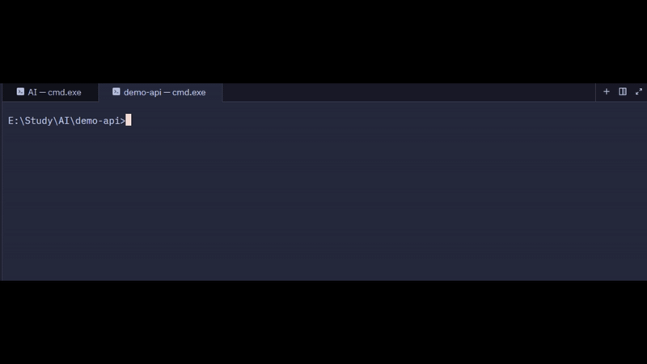

# Git2Tweet

**Turn your git commits into tweet drafts. You approve every one before it goes out.**

[](https://pypi.org/project/git2tweet/)
[](https://pypi.org/project/git2tweet/)
[](https://github.com/Vex-15/git2tweet/blob/main/LICENSE)
[](https://github.com/Vex-15/git2tweet)



Building in public works, but writing about what you shipped is the part everyone skips.
Git2Tweet reads your commit and its diff, decides if it's worth sharing, and writes the
first draft. You stay in control: approve, edit, or reject.

## Install

```bash
uv tool install git2tweet        # or: pipx install git2tweet
git2tweet config                 # choose a provider, paste your API key (once)
```

Needs Python 3.10+, git, and an API key. A free [Groq](https://console.groq.com) key
works, or use [Ollama](https://ollama.com) with no key at all.

## Use it

```bash
git commit -m "feat: add retry with backoff to the webhook handler"
git tweet
```

You'll see a draft. Press `y` to accept, `n` to reject, or type your own version.
Approved tweets open in X with the text prefilled, and you press Post.

## Commands

| Command | What it does |
|---|---|
| `git tweet` (or `g2t`) | Draft a tweet for your latest commit |
| `git tweet <sha>` | Draft for a specific commit |
| `git tweet --no-skip` | Draft even if the commit looks trivial |
| `git tweet --force` | Draft again for an already handled commit |
| `git2tweet config` | Set provider, model and API key (`--show` to view) |
| `git2tweet init` | Add a post-commit reminder hook (`--remove` to undo) |

## How it works

```
commit ─▶ git tweet ─▶ agent reads message + diff ─▶ draft or skip
                                                        │
                       X opens, prefilled ◀─ you approve / edit
```

- An agent built with [LangGraph](https://github.com/langchain-ai/langgraph) uses two tools
  (list commits, read a diff) and pauses for your approval before anything is posted.
- Commits are read from your **local git**, so no GitHub token is needed and private
  repos work.
- Posting uses X's prefilled-tweet link, so Git2Tweet **never sees your X credentials**.
- State is kept in `.git/`, so it never dirties your working tree.

## Providers

| Provider | Setup | Notes |
|---|---|---|
| **Groq** (default) | `git2tweet config` | Fast, has a free tier |
| **Ollama** | `uv tool install "git2tweet[ollama]"`, then `git2tweet config` | Fully local, nothing leaves your machine |

Override per run with `GIT2TWEET_PROVIDER` and `GIT2TWEET_MODEL` environment variables.

## Privacy

- Your commit message and diff are sent to the provider you choose.
- Known secret patterns (API keys, tokens, `password=...`) are redacted first. This is
  best effort, so use Ollama for sensitive repos.
- No telemetry.

## Contributing

Issues and ideas are welcome, especially other platforms (LinkedIn, Bluesky, Mastodon)
and tone presets for drafts.

## License

[MIT](https://github.com/Vex-15/git2tweet/blob/main/LICENSE)
